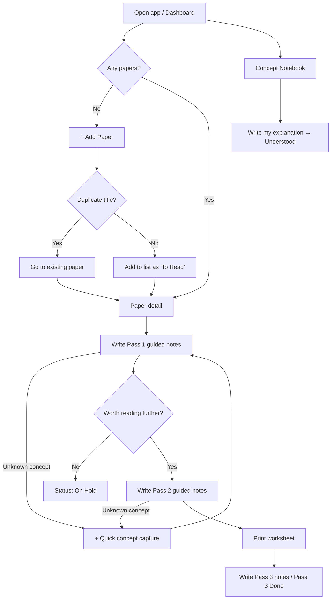

# PRD_PaperPass — 3-Pass Paper Reading Notebook

> Version 0.1 (draft) · 2026-11-19
> Written following the 7-step PRD routine from *Introduction to AI* (Overview → Target User → MVP → User Flow → Inputs & Outputs → Out of Scope → Integration)

---

## 1. Project Overview

### Problem
Undergraduate researchers in a signal processing / optical communications lab find papers on IEEE Xplore, Google Scholar, and arXiv. Papers are written **assuming the reader already knows** concepts such as IM/DD, DMT, ISI, adaptive equalization, or Volterra nonlinearity. As a result, beginners:
- Get pulled away to search every unfamiliar concept, lose the thread, and end up closing the paper after the abstract.
- Finish a paper without knowing what to write down, so nothing sticks — and they look up the same concept again in the next paper.
- Can't track which pass they're on or how much they understood, and have no structured template to annotate alongside a printed PDF.

### Why it matters
- Understanding a research topic (e.g., deep-learning-based nonlinear equalization) requires reading dozens of prior papers. Getting stuck at this stage blocks the research itself.
- Prerequisite concepts repeat across a field. Once written down, they make every subsequent paper faster to read.

### Goal
Use S. Keshav's **three-pass method** (pass 1: skim → pass 2: grasp → pass 3: deep dive) as the backbone. Guide what to write at each pass with **prompt questions**, and collect the **prerequisite concepts** the reader got stuck on so they can be explained in the reader's own words — helping beginner researchers finish a paper and keep a record of it.

### One-line definition
> **"A three-pass paper reading notebook for beginner researchers: jot down the concept you're stuck on and keep reading."**

---

## 2. Target User (Persona)

| Item | Description |
|---|---|
| Who | 3rd–4th year engineering undergraduate, **undergraduate research intern** in a signal processing / optical communications lab |
| Research topic | Deep-learning-based nonlinear equalization (IM/DD optical links, PAM4 and DMT signals) |
| Paper experience | Has read textbooks for courses but has never seriously read research papers |
| Paper sources | IEEE Xplore, Google Scholar, arXiv |
| Usage context | Receives a reading list from the professor or senior students, or finds related papers on Scholar, then reads the PDF on a lab PC. Important papers (pass 3) are printed and annotated by hand |
| Device | **PC (desktop/laptop, viewport ≥ 1280px)**. Mobile is out of scope |
| Current workaround | Highlights the PDF, searches unknown concepts ad hoc, notes scattered across Notepad and paper notebooks |
| Attitude toward sign-up | **Finds it annoying.** It's a personal tool and they want to use it immediately without an account |

---

## 3. Core Features (MVP)

| Priority | Feature | Description | Definition of Done |
|---|---|---|---|
| P1 | **Paper registry & three-pass progress tracking** | Store title, authors, year, venue, source (IEEE Xplore / Scholar / arXiv / Other), link, and tags. Status flows `To Read → Pass 1 Done → Pass 2 Done → Pass 3 Done`. The list supports status and tag filters and title search. | A registered paper persists after page reload, and changing its status immediately updates filter results |
| P1 | **Guided notes per pass + prerequisite concept capture** | Each paper has Pass 1 / 2 / 3 tabs, each with guide questions and answer fields. When an unfamiliar concept appears, the user quickly records just `concept name + location` and moves on. Filling in "My explanation" later marks it `Understood`. A **Concept Notebook** view aggregates concepts across all papers. | A concept recorded in one paper appears in the Concept Notebook, and the same concept name recorded in another paper is merged into one entry showing "Appears in 2 papers" |
| P2 | **Printable pass-3 worksheet** | For pass 3, print paper info, guide questions with handwriting space, and the list of unresolved concepts on 1–2 A4 pages. | The browser print preview shows a clean A4 portrait layout with no buttons or navigation |

### Guide questions (tailored to signal processing)

**Pass 1: Skim (5–10 min)**: read only title, abstract, introduction, figures/tables, conclusion
1. What type of paper is this? (new method / performance analysis / experimental demonstration / survey)
2. In one sentence, what problem does it solve?
3. What is the system setup? (Using Fig. 1, write out transmitter → channel → receiver)
4. What are the three main contributions the authors claim?
5. Is it worth reading further? Why?

**Pass 2: Grasp (~1 hour)**: read the whole body, skipping derivations is fine
1. Explain the proposed method in your own words (follow the block diagram in order)
2. What are the baselines it is compared against?
3. What performance metrics are used? (BER, SNR, Q-factor, EVM, capacity, complexity, etc.)
4. What are the experimental / simulation conditions? (modulation format, data rate, transmission distance, bandwidth, dataset)
5. Pick the single most important figure. What does it show?

**Pass 3: Deep dive (several hours, reading on paper recommended)**
1. What assumptions and limitations do the authors have?
2. What would you need to reproduce the results? (parameters, code, equipment)
3. How does this connect to your own research?
4. Which references should you read next?

### Nice-to-have (excluded from MVP, candidates for v2)
- JSON export/import (backup) → **v2 top priority**, because localStorage is lost when browser data is cleared
- Auto-fill metadata from DOI / arXiv ID
- BibTeX export

---

## 4. User Flow

### 4-1. Reading a new paper (main flow)
1. User opens the web app.
2. On the dashboard, clicks `+ Add Paper`.
3. Enters title, authors, year, source, and link, then clicks `Save`.
4. The paper appears in the list with status "To Read".
5. Clicks the paper card to open the detail view.
6. Answers the guide questions in the Pass 1 tab.
7. When an unfamiliar concept appears, clicks `+ Concept` and enters only its name and location.
8. Clicks `Mark Pass 1 Done`; status changes to "Pass 1 Done".
9. (If continuing) moves to the Pass 2 tab and records notes the same way.
10. Before pass 3, clicks `Print Worksheet` and prints it.
11. Transfers handwritten notes into the Pass 3 tab and clicks `Mark Pass 3 Done`.

### 4-2. Resolving prerequisite concepts
1. Opens `Concept Notebook` from the top navigation.
2. Reviews concepts with status "Unknown".
3. Clicks a concept and writes "My explanation" and reference links.
4. Clicks `Save`; status changes to "Understood".

### 4-3. Edge cases
- **Stopping after pass 1**: answering "No" to Pass 1 question 5 sets status to `On Hold`, and the paper is hidden by the default list filter.
- **Adding a paper that already exists**: if the same title exists (ignoring whitespace and case), show "This paper is already registered. Go to it?"
- **Same concept under different names** (e.g., "ISI" vs. "Intersymbol interference"): the user merges them manually with `Merge` in the Concept Notebook.
- **localStorage write failure**: show "Failed to save. Please check your browser storage." and keep the user's input on screen.

### 4-4. Flowchart

---

## 5. Inputs & Outputs (per screen)

### Screen 1. Dashboard (paper list)
| Aspect | Details |
|---|---|
| Input | Search query (text, max 100 chars) · Status filter (All / To Read / Pass 1 / Pass 2 / Pass 3 Done / On Hold) · Tag filter (multi-select) |
| Processing | Partial match over title, authors, and tags; sorted by most recently modified |
| Output | Paper card: title, authors · year, source badge (IEEE = blue, arXiv = red, Scholar = green, Other = gray), 3-segment progress bar, unresolved concept count ("3 unknown concepts"). Summary header: "4 in progress · 2 done · 7 unresolved concepts". Button `+ Add Paper` |
| Empty state | "No papers yet. Add your first paper." + `+ Add Paper` |
| No results | "No papers match these filters." + `Reset filters` |

### Screen 2. Add / Edit Paper (modal)
| Field | Format / Limits | Required |
|---|---|---|
| Title | Text, 1–300 chars | ✅ |
| Authors | Text, max 300 chars (comma-separated) | |
| Year | 4-digit number, 1950–current year | |
| Venue | Text, max 150 chars (e.g., IEEE Photonics Technology Letters) | |
| Source | Select: IEEE Xplore / Google Scholar / arXiv / Other | ✅ |
| Link | URL (http/https), max 500 chars | |
| Tags | Comma-separated, max 20 chars each, max 10 tags (e.g., equalization, PAM4, deep learning) | |

| Aspect | Details |
|---|---|
| Processing | Validate → check duplicate title → save to localStorage |
| Output | On success, close modal and show toast "Paper added" |
| Error messages | Missing title: "Please enter a title." / Invalid year: "Year must be a 4-digit number between 1950 and 2026." / Invalid link: "Please enter a URL starting with http:// or https://." / Duplicate: "This paper is already registered. Go to it?" (`Go` / `Add anyway`) |

### Screen 3. Paper Detail (guided notes)
| Aspect | Details |
|---|---|
| Input | Answers to guide questions in Pass 1 / 2 / 3 tabs (max 2,000 chars per question; Pass 1 Q5 is Yes/No + reason) · `+ Concept` (concept name 1–50 chars, required; location max 50 chars, e.g., "Sec. II-B, Eq. (3)") |
| Processing | Autosave 1 second after typing stops · `Mark Pass N Done` updates status · Concept names are matched to existing concepts ignoring whitespace and case |
| Output | Header: paper info, `Open Original` link button, pass progress indicator · Save status next to tabs "Saved ✓" · Right panel: this paper's concepts (Unknown = orange, Looked up = yellow, Understood = green) · Buttons `Mark Pass N Done`, `Print Worksheet` |
| Error messages | Missing concept name: "Please enter a concept name." / Save failure: "Failed to save. Please check your browser storage." |

### Screen 4. Concept Notebook
| Aspect | Details |
|---|---|
| Input | Status filter (Unknown / Looked up / Understood) · Select a concept, then "My explanation" (max 1,000 chars) and reference links (URL, max 3) · `Merge` (select 2+ concepts) |
| Processing | Saving an explanation sets status to "Understood" · Saving only links sets "Looked up" · Merge combines the papers-it-appears-in list and explanations into one |
| Output | Concept card: name, status color, "Appears in N papers" (click to list them), explanation preview · Default sort: unresolved first, then by number of papers it appears in |
| Empty state | "No concepts yet. When you hit an unfamiliar concept while reading, jot it down with `+ Concept`." |
| Error messages | Merge with only one selected: "Select at least 2 concepts to merge." |

### Screen 5. Printable Worksheet
| Aspect | Details |
|---|---|
| Input | `Print Worksheet` button on the detail screen |
| Processing | Render a print-only layout (print CSS) and open the browser print dialog |
| Output | A4 portrait, grayscale-friendly · Page 1: paper info + Pass 1/2 answer summary + unresolved concept list (checkboxes) · Page 2: Pass 3 guide questions with handwriting space under each · Buttons, navigation, and colored backgrounds are not printed |

---

## 6. Out of Scope

| # | Not built in this version | Notes |
|---|---|---|
| 1 | Sign-up / login | Personal tool; data stored only in browser localStorage |
| 2 | Cloud sync / multi-device | Single PC |
| 3 | PDF upload, built-in viewer, highlighting | PDFs are read in the user's existing viewer; the app only provides an `Open Original` link |
| 4 | External API integration (IEEE Xplore / Scholar / arXiv search, DOI lookup) | **v2** (starting with arXiv and Crossref APIs) |
| 5 | AI summaries / AI concept explanations | Intentionally excluded: writing it yourself is the core of the learning |
| 6 | Notifications / reminders | |
| 7 | Sharing / collaboration with labmates | **v2** candidate |
| 8 | Mobile layout | PC only (min width 1280px) |
| 9 | Data backup (JSON export/import) | **v2 top priority** |

---

## 7. Technical Constraints (for development)

- Static web app: no backend; all data in localStorage
- Deployment: GitHub repository connected to Vercel
- Development tool: Claude Code (implements from PRD.md and Design.md)
- Design: Google Stitch output stored in `docs/design/`

---

## PRD Checklist

- [x] Can the problem be stated in one sentence? → "Beginners get stuck on concepts papers take for granted, so they don't finish papers and retain nothing."
- [x] Is the user a specific persona? → Undergraduate research intern in a signal processing lab working on deep-learning-based nonlinear equalization
- [x] Are there 3 or fewer MVP features? → 3 (two P1, one P2)
- [x] Does every screen have inputs and outputs? → All 5 screens specified
- [x] Are there at least 3 out-of-scope items? → 9
