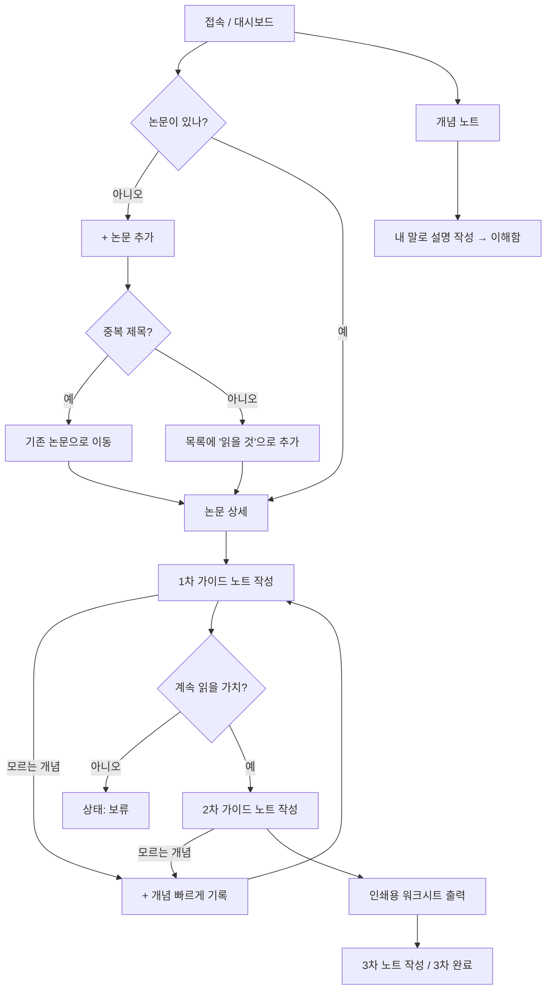

# PRD_PaperPass — 3-pass 논문 읽기 노트

> 버전 0.1 (초안) · 2026-11-19
> 작성 루틴: 인공지능입문 PRD 작성 루틴 7단계 (개요 → 타겟 → MVP → 사용자 흐름 → 입력과 출력 → 제외 범위 → 통합)

---

## 1. 프로젝트 개요

### 해결하려는 문제
신호처리·광통신 연구실의 학부연구생은 IEEE Xplore, Google Scholar, arXiv에서 논문을 받아 읽는다. 그런데 논문은 IM/DD, DMT, ISI, 적응 등화, Volterra 비선형성 같은 개념을 **독자가 이미 안다고 전제하고** 서술한다. 그래서 초보자는 다음 문제를 겪는다.
- 모르는 개념이 나올 때마다 검색하다가 읽기 흐름이 끊기고, 결국 초록만 읽고 덮는다.
- 끝까지 읽어도 무엇을 기록해야 할지 몰라서 남는 것이 없다. 같은 개념을 다음 논문에서 또 찾아본다.
- 몇 번째 읽는 중인지, 어디까지 이해했는지 관리하지 못한다. 진지하게 읽으려고 출력한 PDF 옆에 메모할 틀도 없다.

### 왜 중요한가
- 연구 주제(예: 딥러닝 기반 비선형 등화)를 이해하려면 선행 논문 수십 편을 읽어야 한다. 이 단계에서 막히면 연구 자체가 시작되지 않는다.
- 전제 개념은 분야 안에서 반복된다. 한 번 정리해 두면 다음 논문부터 읽는 속도가 빨라진다.

### 목적
S. Keshav의 **3-pass 읽기법**(1차 훑기 → 2차 이해 → 3차 깊이)을 기본 틀로 삼는다. 단계마다 무엇을 써야 하는지 **가이드 질문**으로 안내하고, 읽다가 막힌 **전제 개념**을 따로 모아 내 말로 정리하게 해서, 초보 연구자가 논문 한 편을 끝까지 읽고 기록을 남기도록 돕는다.

### 한 줄 정의
> **"막히는 개념은 적어두고 다음으로 넘어가는, 초보 연구자를 위한 3-pass 논문 읽기 노트"**

---

## 2. 주요 타겟 (대표 사용자)

| 항목 | 내용 |
|---|---|
| 인물 | 공대 학부 3~4학년, 신호처리·광통신 연구실 **학부연구생** |
| 연구 주제 | 딥러닝 기반 비선형 등화 (IM/DD 광링크, PAM4·DMT 신호) |
| 논문 경험 | 수업 교재는 읽어 봤지만 논문을 본격적으로 읽은 적은 없음 |
| 논문 출처 | IEEE Xplore, Google Scholar, arXiv |
| 사용 상황 | 교수님·선배가 논문 목록을 주거나 Scholar로 관련 논문을 찾은 뒤, 연구실 PC에서 PDF를 열어 읽음. 중요한 논문(3차 읽기)은 출력해서 손으로 메모하며 읽음 |
| 사용 기기 | **PC (데스크톱/노트북, 화면 폭 1280px 이상)**. 모바일은 고려하지 않음 |
| 현재 해결 방식 | PDF에 형광펜을 칠하고, 모르는 개념은 그때그때 검색하고, 메모는 메모장이나 노트에 흩어져 있음 |
| 회원가입 태도 | **귀찮아함.** 혼자 쓰는 도구라 계정 없이 바로 쓰고 싶어 함 |

---

## 3. 핵심 기능 (MVP)

| 우선순위 | 기능 | 설명 | 완료 기준 |
|---|---|---|---|
| P1 | **논문 등록 및 3-pass 진행 관리** | 제목·저자·연도·게재처·출처(IEEE Xplore / Scholar / arXiv / 기타)·링크·태그를 저장한다. 상태는 `읽을 것 → 1차 완료 → 2차 완료 → 3차 완료`로 관리한다. 목록에서 상태·태그 필터와 제목 검색을 지원한다. | 논문을 등록하고 새로고침해도 목록에 남아 있으며, 상태를 바꾸면 필터 결과가 즉시 바뀐다 |
| P1 | **단계별 가이드 노트 + 전제 개념 기록** | 논문마다 1·2·3차 탭이 있고, 탭마다 가이드 질문과 답변 칸이 있다. 읽다가 모르는 개념이 나오면 `개념명 + 나온 위치`만 빠르게 적고 넘어간다. 나중에 '내 말로 설명'을 채우면 상태가 `이해함`이 된다. 전체 논문의 개념을 모아 보는 **개념 노트** 화면을 제공한다. | 한 논문에서 기록한 개념이 개념 노트에 나타나고, 같은 개념명이 다른 논문에서 나오면 하나로 묶여 '등장 논문 2편'으로 표시된다 |
| P2 | **인쇄용 3차 읽기 워크시트** | 3차 읽기용으로 논문 정보, 가이드 질문, 손글씨 여백, 미해결 개념 목록을 A4 1~2장에 인쇄한다. | 브라우저 인쇄 미리보기에서 A4 세로로 버튼·내비게이션 없이 깔끔하게 출력된다 |

### 가이드 질문 (신호처리 분야 맞춤)

**1차: 훑기 (5~10분)**: 제목, 초록, 서론, 그림·표, 결론만 읽기
1. 논문 유형은? (새 기법 제안 / 성능 분석 / 실험 시연 / 서베이)
2. 이 논문이 푸는 문제를 한 문장으로 쓰면?
3. 시스템 구성은? (그림 1을 보고 송신기 → 채널 → 수신기를 적기)
4. 저자가 주장하는 주요 기여 3가지는?
5. 계속 읽을 가치가 있나? 이유는?

**2차: 이해 (약 1시간)**: 본문 전체, 수식 유도는 건너뛰어도 됨
1. 제안 기법을 내 말로 설명하면? (블록도 순서대로)
2. 비교 대상(baseline)은 무엇인가?
3. 성능 지표는? (BER, SNR, Q-factor, EVM, 전송용량, 복잡도 등)
4. 실험·시뮬레이션 조건은? (변조 방식, 데이터율, 전송 거리, 대역폭, 데이터셋)
5. 가장 중요한 그림 1개와, 그 그림이 보여주는 것은?

**3차: 깊이 (수 시간, 출력해서 읽기 권장)**
1. 저자가 둔 가정과 한계는?
2. 이 결과를 재현하려면 무엇이 필요한가? (파라미터, 코드, 장비)
3. 내 연구와 어떻게 연결되는가?
4. 다음에 읽을 참고문헌은?

### 없어도 되는 기능 (MVP 제외, 2차 버전 후보)
- JSON 내보내기/가져오기 (백업) → **2차 버전 1순위**. localStorage는 브라우저 데이터를 지우면 사라지기 때문이다.
- DOI·arXiv ID로 서지정보 자동 채우기
- BibTeX 내보내기

---

## 4. 사용자 흐름 (User Flow)

### 4-1. 새 논문 읽기 (기본 흐름)
1. 사용자가 웹앱에 접속한다.
2. 대시보드에서 `+ 논문 추가`를 누른다.
3. 제목·저자·연도·출처·링크를 입력하고 `저장`을 누른다.
4. 목록에 '읽을 것' 상태로 논문이 추가된다.
5. 논문 카드를 눌러 상세 화면으로 들어간다.
6. 1차 탭의 가이드 질문에 답을 적는다.
7. 읽다가 모르는 개념이 나오면 `+ 개념` 버튼으로 개념명과 위치만 적는다.
8. `1차 완료`를 누르면 상태가 '1차 완료'로 바뀐다.
9. (계속 읽을 경우) 2차 탭으로 이동해 같은 방식으로 기록한다.
10. 3차를 읽기 전에 `인쇄용 워크시트`를 눌러 출력한다.
11. 손으로 메모한 내용을 3차 탭에 옮겨 적고 `3차 완료`를 누른다.

### 4-2. 전제 개념 정리하기
1. 상단 메뉴에서 `개념 노트`를 연다.
2. '모름' 상태의 개념 목록을 확인한다.
3. 개념을 눌러 '내 말로 설명'과 참고 링크를 적는다.
4. `저장`을 누르면 상태가 '이해함'으로 바뀐다.

### 4-3. 예외 상황
- **1차만 읽고 그만둘 때**: 1차 탭의 5번 질문에 '아니오'를 체크하면 상태가 `보류`가 되고, 목록 기본 필터에서 숨겨진다.
- **이미 등록한 논문을 또 추가할 때**: 같은 제목(공백·대소문자 무시)이 있으면 "이미 등록된 논문입니다. 해당 논문으로 이동할까요?"를 보여준다.
- **같은 개념을 다른 이름으로 적었을 때** (예: "ISI"와 "Intersymbol interference"): 개념 노트에서 `합치기`로 수동 병합한다.
- **저장 공간(localStorage) 오류**: "저장에 실패했습니다. 브라우저 저장 공간을 확인해 주세요."를 표시하고, 입력 내용은 화면에 유지한다.

### 4-4. 순서도

---

## 5. 입력과 출력 (화면별)

### 화면 1. 대시보드 (논문 목록)
| 구분 | 내용 |
|---|---|
| 입력 | 검색어 (텍스트, 최대 100자) · 상태 필터 (전체 / 읽을 것 / 1차 / 2차 / 3차 완료 / 보류) · 태그 필터 (다중 선택) |
| 처리 | 제목·저자·태그에서 부분 일치 검색, 최근 수정순 정렬 |
| 출력 | 논문 카드: 제목, 저자·연도, 출처 배지(IEEE=파랑, arXiv=빨강, Scholar=초록, 기타=회색), 진행 바(3칸), 미해결 개념 수 ("모르는 개념 3"). 상단 요약 "읽는 중 4 · 완료 2 · 미해결 개념 7". 버튼 `+ 논문 추가` |
| 빈 상태 | "아직 등록한 논문이 없어요. 첫 논문을 추가해 보세요." + `+ 논문 추가` |
| 검색 결과 없음 | "조건에 맞는 논문이 없습니다." + `필터 초기화` |

### 화면 2. 논문 추가 / 수정 (모달)
| 필드 | 형식 / 제한 | 필수 |
|---|---|---|
| 제목 | 텍스트, 1~300자 | ✅ |
| 저자 | 텍스트, 최대 300자 (쉼표로 구분) | |
| 연도 | 숫자 4자리, 1950~현재 연도 | |
| 게재처 | 텍스트, 최대 150자 (예: IEEE Photonics Technology Letters) | |
| 출처 | 선택: IEEE Xplore / Google Scholar / arXiv / 기타 | ✅ |
| 링크 | URL (http/https), 최대 500자 | |
| 태그 | 쉼표 구분, 태그당 최대 20자, 최대 10개 (예: 등화, PAM4, 딥러닝) | |

| 구분 | 내용 |
|---|---|
| 처리 | 유효성 검사 → 중복 제목 확인 → localStorage 저장 |
| 출력 | 성공 시 모달이 닫히고 토스트 "논문이 추가되었습니다" 표시 |
| 오류 문구 | 제목 없음: "제목을 입력해 주세요." / 연도 형식: "연도는 1950~2026 사이 4자리 숫자로 입력해 주세요." / 링크 형식: "http:// 또는 https://로 시작하는 주소를 입력해 주세요." / 중복: "이미 등록된 논문입니다. 해당 논문으로 이동할까요?" (`이동` / `그래도 추가`) |

### 화면 3. 논문 상세 (가이드 노트)
| 구분 | 내용 |
|---|---|
| 입력 | 1·2·3차 탭별 가이드 질문 답변 (질문당 최대 2,000자, 1차 5번은 예/아니오 + 이유) · `+ 개념` (개념명 1~50자 필수, 나온 위치 최대 50자 예: "Sec. II-B, 식 (3)") |
| 처리 | 입력 후 1초 뒤 자동 저장 · `N차 완료`를 누르면 상태 갱신 · 개념명은 공백·대소문자를 무시하고 기존 개념과 매칭 |
| 출력 | 상단: 논문 정보, 출처 링크 버튼 `원문 열기`, 진행 단계 표시 · 탭 옆 저장 상태 "저장됨 ✓" · 우측 패널: 이 논문의 개념 목록 (모름=주황, 찾아봄=노랑, 이해함=초록) · 버튼 `N차 완료`, `인쇄용 워크시트` |
| 오류 문구 | 개념명 없음: "개념 이름을 입력해 주세요." / 저장 실패: "저장에 실패했습니다. 브라우저 저장 공간을 확인해 주세요." |

### 화면 4. 개념 노트
| 구분 | 내용 |
|---|---|
| 입력 | 상태 필터 (모름 / 찾아봄 / 이해함) · 개념 선택 후 '내 말로 설명' (최대 1,000자), 참고 링크 (URL, 최대 3개) · `합치기` (개념 2개 이상 선택) |
| 처리 | 설명을 저장하면 상태를 '이해함'으로 · 링크만 저장하면 '찾아봄'으로 · 합치기는 등장 논문 목록과 설명을 하나로 병합 |
| 출력 | 개념 카드: 개념명, 상태 색, "등장 논문 N편" (누르면 해당 논문 목록), 내 설명 미리보기 · 기본 정렬: 미해결 개념 중 등장 논문이 많은 순 |
| 빈 상태 | "아직 기록한 개념이 없어요. 논문을 읽다가 모르는 개념이 나오면 `+ 개념`으로 적어 두세요." |
| 오류 문구 | 합치기 1개만 선택: "합칠 개념을 2개 이상 선택해 주세요." |

### 화면 5. 인쇄용 워크시트
| 구분 | 내용 |
|---|---|
| 입력 | 상세 화면의 `인쇄용 워크시트` 버튼 |
| 처리 | 인쇄 전용 레이아웃(print CSS)으로 렌더링한 뒤 브라우저 인쇄 대화상자 호출 |
| 출력 | A4 세로, 흑백 기준 · 1쪽: 논문 정보 + 1·2차 답변 요약 + 미해결 개념 목록(체크박스) · 2쪽: 3차 가이드 질문과 질문마다 손글씨 여백 · 버튼·메뉴·색 배경은 인쇄하지 않음 |

---

## 6. 제외 범위 (Out of Scope)

| # | 이번 버전에서 만들지 않는 기능 | 비고 |
|---|---|---|
| 1 | 회원가입·로그인 | 개인용 도구. 데이터는 브라우저 localStorage에만 저장 |
| 2 | 클라우드 동기화·여러 기기 사용 | PC 한 대 기준 |
| 3 | PDF 업로드·내장 뷰어·하이라이트 | PDF는 기존 뷰어로 읽고, 앱은 `원문 열기` 링크만 제공 |
| 4 | 외부 API 연동 (IEEE Xplore / Scholar / arXiv 검색, DOI 자동 조회) | **2차 버전** (arXiv·Crossref API부터) |
| 5 | AI 요약·AI 개념 설명 | 직접 쓰는 과정이 학습의 핵심이므로 의도적으로 제외 |
| 6 | 알림·리마인더 | |
| 7 | 공유·협업 (연구실 동료와 노트 공유) | **2차 버전** 후보 |
| 8 | 모바일 레이아웃 | PC 전용 (최소 폭 1280px) |
| 9 | 데이터 백업 (JSON 내보내기/가져오기) | **2차 버전 1순위** |

---

## 7. 기술 조건 (개발 참고)

- 정적 웹앱: 백엔드 없음, 모든 데이터는 localStorage에 저장
- 배포: GitHub 저장소를 Vercel에 연결
- 개발 도구: Claude Code (PRD.md와 Design.md를 기준으로 구현)
- 디자인: Google Stitch 결과물을 `docs/design/`에 둔다

---

## PRD 점검표

- [x] 문제를 한 문장으로 말할 수 있는가? → "논문이 전제하는 개념에서 막혀 끝까지 읽지 못하고, 읽어도 기록이 남지 않는다"
- [x] 사용자를 특정 인물로 적었는가? → 딥러닝 비선형 등화를 연구하는 신호처리 연구실 학부연구생
- [x] MVP 기능이 3개 이하인가? → 3개 (P1 2개, P2 1개)
- [x] 모든 화면에 입력과 출력이 있는가? → 화면 5개 모두 작성
- [x] 제외 범위가 3개 이상인가? → 9개
