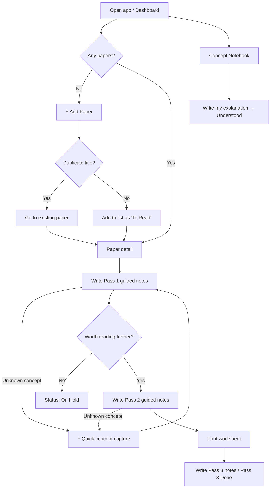

# AI Studio 입력용 — PaperPass

아래 문서 전체를 Google AI Studio의 Build 채팅창에 그대로 붙여넣으세요.
Stitch 화면 이미지(`docs/design/stitch_paperpass_research_app/*/screen.png`)를 함께 첨부하면 더 비슷하게 만들어집니다.

---

## 요청

아래 'PRD.md'와 'Design.md'를 토대로 웹앱을 개발해줘.

반드시 지킬 조건:
1. 앱 이름은 PaperPass, 화면 글자는 한국어로 해줘.
2. **Gemini API나 AI 기능은 넣지 마.** PRD의 제외 범위(Out of Scope)에 AI 요약·AI 개념 설명이 있어. 사용자가 직접 써야 하는 앱이야.
3. 로그인, 서버, 외부 API 없이 모든 데이터는 브라우저 localStorage에 저장해줘. 새로고침해도 데이터가 남아 있어야 해.
4. PC 전용(화면 폭 1280px 이상)으로 만들어줘.
5. 화면은 5개야: ① 대시보드(논문 목록) ② 논문 추가/수정 모달 ③ 논문 상세(1·2·3차 탭 가이드 질문 + 오른쪽 전제 개념 패널) ④ 개념 노트(합치기 포함) ⑤ A4 인쇄용 3차 워크시트(@media print).
6. 가이드 질문, 입력 글자 수 제한, 오류 문구, 빈 화면 문구는 PRD에 적힌 그대로 써줘.
7. 색·폰트·간격은 Design.md의 토큰을 따라줘. 출처 배지(IEEE 파랑, arXiv 빨강, Scholar 초록, 기타 회색)와 개념 상태(모름 주황, 찾아봄 노랑, 이해함 초록) 색은 꼭 지켜줘.

---

# PRD.md

# PRD_PaperPass — 3-Pass Paper Reading Notebook

> Version 0.1 (draft) · 2026-11-19
> Written following the 7-step PRD routine from *Introduction to AI* (Overview → Target User → MVP → User Flow → Inputs & Outputs → Out of Scope → Integration)

---

## 1. Project Overview

### Problem
Undergraduate researchers in a signal processing / optical communications lab find papers on IEEE Xplore, Google Scholar, and arXiv. Papers are written **assuming the reader already knows** concepts such as IM/DD, DMT, ISI, adaptive equalization, or Volterra nonlinearity. As a result, beginners:
- Get pulled away to search every unfamiliar concept, lose the thread, and end up closing the paper after the abstract.
- Finish a paper without knowing what to write down, so nothing sticks — and they look up the same concept again in the next paper.
- Can't track which pass they're on or how much they understood, and have no structured template to annotate alongside a printed PDF.

### Why it matters
- Understanding a research topic (e.g., deep-learning-based nonlinear equalization) requires reading dozens of prior papers. Getting stuck at this stage blocks the research itself.
- Prerequisite concepts repeat across a field. Once written down, they make every subsequent paper faster to read.

### Goal
Use S. Keshav's **three-pass method** (pass 1: skim → pass 2: grasp → pass 3: deep dive) as the backbone. Guide what to write at each pass with **prompt questions**, and collect the **prerequisite concepts** the reader got stuck on so they can be explained in the reader's own words — helping beginner researchers finish a paper and keep a record of it.

### One-line definition
> **"A three-pass paper reading notebook for beginner researchers: jot down the concept you're stuck on and keep reading."**

---

## 2. Target User (Persona)

| Item | Description |
|---|---|
| Who | 3rd–4th year engineering undergraduate, **undergraduate research intern** in a signal processing / optical communications lab |
| Research topic | Deep-learning-based nonlinear equalization (IM/DD optical links, PAM4 and DMT signals) |
| Paper experience | Has read textbooks for courses but has never seriously read research papers |
| Paper sources | IEEE Xplore, Google Scholar, arXiv |
| Usage context | Receives a reading list from the professor or senior students, or finds related papers on Scholar, then reads the PDF on a lab PC. Important papers (pass 3) are printed and annotated by hand |
| Device | **PC (desktop/laptop, viewport ≥ 1280px)**. Mobile is out of scope |
| Current workaround | Highlights the PDF, searches unknown concepts ad hoc, notes scattered across Notepad and paper notebooks |
| Attitude toward sign-up | **Finds it annoying.** It's a personal tool and they want to use it immediately without an account |

---

## 3. Core Features (MVP)

| Priority | Feature | Description | Definition of Done |
|---|---|---|---|
| P1 | **Paper registry & three-pass progress tracking** | Store title, authors, year, venue, source (IEEE Xplore / Scholar / arXiv / Other), link, and tags. Status flows `To Read → Pass 1 Done → Pass 2 Done → Pass 3 Done`. The list supports status and tag filters and title search. | A registered paper persists after page reload, and changing its status immediately updates filter results |
| P1 | **Guided notes per pass + prerequisite concept capture** | Each paper has Pass 1 / 2 / 3 tabs, each with guide questions and answer fields. When an unfamiliar concept appears, the user quickly records just `concept name + location` and moves on. Filling in "My explanation" later marks it `Understood`. A **Concept Notebook** view aggregates concepts across all papers. | A concept recorded in one paper appears in the Concept Notebook, and the same concept name recorded in another paper is merged into one entry showing "Appears in 2 papers" |
| P2 | **Printable pass-3 worksheet** | For pass 3, print paper info, guide questions with handwriting space, and the list of unresolved concepts on 1–2 A4 pages. | The browser print preview shows a clean A4 portrait layout with no buttons or navigation |

### Guide questions (tailored to signal processing)

**Pass 1: Skim (5–10 min)**: read only title, abstract, introduction, figures/tables, conclusion
1. What type of paper is this? (new method / performance analysis / experimental demonstration / survey)
2. In one sentence, what problem does it solve?
3. What is the system setup? (Using Fig. 1, write out transmitter → channel → receiver)
4. What are the three main contributions the authors claim?
5. Is it worth reading further? Why?

**Pass 2: Grasp (~1 hour)**: read the whole body, skipping derivations is fine
1. Explain the proposed method in your own words (follow the block diagram in order)
2. What are the baselines it is compared against?
3. What performance metrics are used? (BER, SNR, Q-factor, EVM, capacity, complexity, etc.)
4. What are the experimental / simulation conditions? (modulation format, data rate, transmission distance, bandwidth, dataset)
5. Pick the single most important figure. What does it show?

**Pass 3: Deep dive (several hours, reading on paper recommended)**
1. What assumptions and limitations do the authors have?
2. What would you need to reproduce the results? (parameters, code, equipment)
3. How does this connect to your own research?
4. Which references should you read next?

### Nice-to-have (excluded from MVP, candidates for v2)
- JSON export/import (backup) → **v2 top priority**, because localStorage is lost when browser data is cleared
- Auto-fill metadata from DOI / arXiv ID
- BibTeX export

---

## 4. User Flow

### 4-1. Reading a new paper (main flow)
1. User opens the web app.
2. On the dashboard, clicks `+ Add Paper`.
3. Enters title, authors, year, source, and link, then clicks `Save`.
4. The paper appears in the list with status "To Read".
5. Clicks the paper card to open the detail view.
6. Answers the guide questions in the Pass 1 tab.
7. When an unfamiliar concept appears, clicks `+ Concept` and enters only its name and location.
8. Clicks `Mark Pass 1 Done`; status changes to "Pass 1 Done".
9. (If continuing) moves to the Pass 2 tab and records notes the same way.
10. Before pass 3, clicks `Print Worksheet` and prints it.
11. Transfers handwritten notes into the Pass 3 tab and clicks `Mark Pass 3 Done`.

### 4-2. Resolving prerequisite concepts
1. Opens `Concept Notebook` from the top navigation.
2. Reviews concepts with status "Unknown".
3. Clicks a concept and writes "My explanation" and reference links.
4. Clicks `Save`; status changes to "Understood".

### 4-3. Edge cases
- **Stopping after pass 1**: answering "No" to Pass 1 question 5 sets status to `On Hold`, and the paper is hidden by the default list filter.
- **Adding a paper that already exists**: if the same title exists (ignoring whitespace and case), show "This paper is already registered. Go to it?"
- **Same concept under different names** (e.g., "ISI" vs. "Intersymbol interference"): the user merges them manually with `Merge` in the Concept Notebook.
- **localStorage write failure**: show "Failed to save. Please check your browser storage." and keep the user's input on screen.

### 4-4. Flowchart

---

## 5. Inputs & Outputs (per screen)

### Screen 1. Dashboard (paper list)
| Aspect | Details |
|---|---|
| Input | Search query (text, max 100 chars) · Status filter (All / To Read / Pass 1 / Pass 2 / Pass 3 Done / On Hold) · Tag filter (multi-select) |
| Processing | Partial match over title, authors, and tags; sorted by most recently modified |
| Output | Paper card: title, authors · year, source badge (IEEE = blue, arXiv = red, Scholar = green, Other = gray), 3-segment progress bar, unresolved concept count ("3 unknown concepts"). Summary header: "4 in progress · 2 done · 7 unresolved concepts". Button `+ Add Paper` |
| Empty state | "No papers yet. Add your first paper." + `+ Add Paper` |
| No results | "No papers match these filters." + `Reset filters` |

### Screen 2. Add / Edit Paper (modal)
| Field | Format / Limits | Required |
|---|---|---|
| Title | Text, 1–300 chars | ✅ |
| Authors | Text, max 300 chars (comma-separated) | |
| Year | 4-digit number, 1950–current year | |
| Venue | Text, max 150 chars (e.g., IEEE Photonics Technology Letters) | |
| Source | Select: IEEE Xplore / Google Scholar / arXiv / Other | ✅ |
| Link | URL (http/https), max 500 chars | |
| Tags | Comma-separated, max 20 chars each, max 10 tags (e.g., equalization, PAM4, deep learning) | |

| Aspect | Details |
|---|---|
| Processing | Validate → check duplicate title → save to localStorage |
| Output | On success, close modal and show toast "Paper added" |
| Error messages | Missing title: "Please enter a title." / Invalid year: "Year must be a 4-digit number between 1950 and 2026." / Invalid link: "Please enter a URL starting with http:// or https://." / Duplicate: "This paper is already registered. Go to it?" (`Go` / `Add anyway`) |

### Screen 3. Paper Detail (guided notes)
| Aspect | Details |
|---|---|
| Input | Answers to guide questions in Pass 1 / 2 / 3 tabs (max 2,000 chars per question; Pass 1 Q5 is Yes/No + reason) · `+ Concept` (concept name 1–50 chars, required; location max 50 chars, e.g., "Sec. II-B, Eq. (3)") |
| Processing | Autosave 1 second after typing stops · `Mark Pass N Done` updates status · Concept names are matched to existing concepts ignoring whitespace and case |
| Output | Header: paper info, `Open Original` link button, pass progress indicator · Save status next to tabs "Saved ✓" · Right panel: this paper's concepts (Unknown = orange, Looked up = yellow, Understood = green) · Buttons `Mark Pass N Done`, `Print Worksheet` |
| Error messages | Missing concept name: "Please enter a concept name." / Save failure: "Failed to save. Please check your browser storage." |

### Screen 4. Concept Notebook
| Aspect | Details |
|---|---|
| Input | Status filter (Unknown / Looked up / Understood) · Select a concept, then "My explanation" (max 1,000 chars) and reference links (URL, max 3) · `Merge` (select 2+ concepts) |
| Processing | Saving an explanation sets status to "Understood" · Saving only links sets "Looked up" · Merge combines the papers-it-appears-in list and explanations into one |
| Output | Concept card: name, status color, "Appears in N papers" (click to list them), explanation preview · Default sort: unresolved first, then by number of papers it appears in |
| Empty state | "No concepts yet. When you hit an unfamiliar concept while reading, jot it down with `+ Concept`." |
| Error messages | Merge with only one selected: "Select at least 2 concepts to merge." |

### Screen 5. Printable Worksheet
| Aspect | Details |
|---|---|
| Input | `Print Worksheet` button on the detail screen |
| Processing | Render a print-only layout (print CSS) and open the browser print dialog |
| Output | A4 portrait, grayscale-friendly · Page 1: paper info + Pass 1/2 answer summary + unresolved concept list (checkboxes) · Page 2: Pass 3 guide questions with handwriting space under each · Buttons, navigation, and colored backgrounds are not printed |

---

## 6. Out of Scope

| # | Not built in this version | Notes |
|---|---|---|
| 1 | Sign-up / login | Personal tool; data stored only in browser localStorage |
| 2 | Cloud sync / multi-device | Single PC |
| 3 | PDF upload, built-in viewer, highlighting | PDFs are read in the user's existing viewer; the app only provides an `Open Original` link |
| 4 | External API integration (IEEE Xplore / Scholar / arXiv search, DOI lookup) | **v2** (starting with arXiv and Crossref APIs) |
| 5 | AI summaries / AI concept explanations | Intentionally excluded: writing it yourself is the core of the learning |
| 6 | Notifications / reminders | |
| 7 | Sharing / collaboration with labmates | **v2** candidate |
| 8 | Mobile layout | PC only (min width 1280px) |
| 9 | Data backup (JSON export/import) | **v2 top priority** |

---

## 7. Technical Constraints (for development)

- Static web app: no backend; all data in localStorage
- Deployment: GitHub repository connected to Vercel
- Development tool: Claude Code (implements from PRD.md and Design.md)
- Design: Google Stitch output stored in `docs/design/`

---

## PRD Checklist

- [x] Can the problem be stated in one sentence? → "Beginners get stuck on concepts papers take for granted, so they don't finish papers and retain nothing."
- [x] Is the user a specific persona? → Undergraduate research intern in a signal processing lab working on deep-learning-based nonlinear equalization
- [x] Are there 3 or fewer MVP features? → 3 (two P1, one P2)
- [x] Does every screen have inputs and outputs? → All 5 screens specified
- [x] Are there at least 3 out-of-scope items? → 9

---

# Design.md

## Part 1. 디자인 가이드

# DESIGN.md — PaperPass 디자인 시스템 및 UI 가이드

> 버전: 1.0  
> 프로젝트: PaperPass (학부연구생을 위한 3-pass 논문 읽기 노트)  
> 타겟 기기: 데스크톱 전용 웹 (최소 해상도 1280px 이상)  
> 대상 독자: 신호처리·광통신 연구실 학부연구생 (딥러닝 비선형 등화 연구)

---

## 1. 디자인 철학 및 비주얼 아이덴티티

PaperPass는 신호처리·광통신 분야의 복잡한 논문(수식, 블록도, 생소한 통신 약어)을 읽는 학부연구생의 **인지 부하(Cognitive Load)를 최소화**하고, S. Keshav의 **3-pass 읽기법**을 자연스럽게 실천할 수 있도록 설계된 **학술 정밀(Academic Precision)** 테마의 웹 애플리케이션입니다.

### 핵심 원칙
1. **차분하고 정갈한 여백 (Calm & Distraction-Free)**: 화려한 장식이나 불필요한 그라데이션을 배제하고, 차분한 오프화이트(Off-white)와 슬레이트 그레이(Slate Gray)를 베이스로 수식과 긴 텍스트에 온전히 몰입할 수 있도록 돕습니다.
2. **명확한 색상 시맨틱 (Semantic Consistency)**: 논문 출처와 개념 이해 상태를 엄격한 색상 규칙으로 시각화하여 사용자가 한눈에 읽기 상태를 파악할 수 있습니다.
3. **손글씨와 디지털의 가교 (Print-to-Digital Bridge)**: 3차 읽기는 출력해서 줄 치며 읽는 연구생의 실제 행동 패턴을 반영하여, 인쇄 전용 A4 고대비 워크시트를 제공합니다.

---

## 2. 컬러 팔레트 (Color Palette)

### 2-1. 뉴트럴 & 서피스 (Neutral & Surface)
| 토큰 | Hex 코드 | 용도 |
|---|---|---|
| `bg-app` | `#f8f9ff` / `#f8fafc` | 앱 전체 배경 (눈의 피로도를 낮추는 미세한 쿨그레이) |
| `surface-white` | `#ffffff` | 카드, 모달, 메인 가이드 노트 본문 배경 |
| `surface-muted` | `#f1f5f9` (Slate-100) | 서브 패널, 태그 칩 배경, 입력창 기본 배경 |
| `border-subtle` | `#e2e8f0` (Slate-200) | 카드 및 섹션 구분선 |
| `text-primary` | `#0f172a` (Slate-900) | 제목, 주요 가이드 질문, 논문 제목 |
| `text-secondary` | `#475569` (Slate-600) | 저자, 게재처, 설명 보조 문구 |
| `text-muted` | `#94a3b8` (Slate-400) | 플레이스홀더, 비활성 탭, 힌트 텍스트 |

### 2-2. 논문 출처 배지 (Paper Source Badges)
PRD 5장 명세에 따라 출처별 고유 배지 색상을 엄격히 유지합니다.
- **IEEE Xplore**: 파랑 계열 (`#2563eb` Blue-600, 배경 `#dbeafe` Blue-100)
- **arXiv**: 빨강 계열 (`#dc2626` Red-600, 배경 `#fee2e2` Red-100)
- **Google Scholar**: 초록 계열 (`#059669` Emerald-600, 배경 `#d1fae5` Emerald-100)
- **기타 (Other)**: 회색 계열 (`#4b5563` Gray-600, 배경 `#f3f4f6` Gray-100)

### 2-3. 전제 개념 이해 상태 배지 (Concept Status Tags)
PRD 5장 및 3장 명세에 따라 신호등/단계별 색상을 적용합니다.
- **모름 (Unknown)**: 주황 계열 (`#d97706` Amber-600, 배경 `#fef3c7` Amber-100) — *즉시 넘어가고 나중에 채울 것*
- **찾아봄 (Looked up)**: 노랑 계열 (`#ca8a04` Yellow-600, 배경 `#fef9c3` Yellow-100) — *참고 링크나 기초 자료 확인*
- **이해함 (Understood)**: 초록 계열 (`#16a34a` Green-600, 배경 `#dcfce7` Green-100) — *내 말로 설명 완료*

---

## 3. 타이포그래피 (Typography)

- **UI & 시스템 텍스트**: `Pretendard`, `Inter`, `-apple-system`, `sans-serif`
  - 한국어와 영문이 혼용되는 신호처리 용어(예: *112-Gb/s PAM4 IM/DD 광링크 비선형 등화*)를 왜곡 없이 선명하게 표시합니다.
- **논문 제목 (Title Nuance)**: `Newsreader`, `Merriweather`, `serif`
  - 학술 논문 특유의 지적이고 권위 있는 인상을 제공하며, 카드 및 상세 헤더에서 본문과 뚜렷한 시각적 위계를 만듭니다.
- **수식 및 섹션 인용 (Formulas & Section Mentions)**: `JetBrains Mono`, `ui-monospace`, `monospace`
  - `Sec. II-B, 식 (3)`, `HD-FEC limit (3.8 × 10⁻³)` 등 정확한 인덱싱 텍스트에 적용합니다.

---

## 4. 컴포넌트 패턴 (Component Patterns)

### 4-1. 3-Pass 진행 상태 바 (3-Pass Progress Indicator)
- 3개의 연속된 세그먼트 막대로 구성 (`1차 훑기` → `2차 이해` → `3차 깊이`)
- `읽을 것`: 0/3 (모두 비어 있음, 회색 테두리)
- `1차 완료`: 1/3 (첫 번째 칸 Scholar Blue `#2563eb` 점유)
- `2차 완료`: 2/3 (두 번째 칸까지 파랑 점유)
- `3차 완료`: 3/3 (전체 초록색 `#16a34a` 완료 표시)

### 4-2. 듀얼 패널 작업 공간 (Dual-Panel Workspace)
- **좌측 (70%)**: 1·2·3차 탭 전환 및 가이드 질문 입력 폼. 입력 후 1초 자동 저장 인디케이터(`저장됨 ✓`).
- **우측 (30% Sticky Panel)**: 해당 논문에서 등록된 개념 목록을 상시 띄워두고, 논문을 읽다가 모르는 단어가 생겼을 때 읽기 흐름을 깨지 않고 3초 안에 `+ 개념명 + 위치`만 기록할 수 있는 간이 인풋 제공.

### 4-3. A4 인쇄용 워크시트 스타일 (@media print)
- `@media print` 시 상단 글로벌 내비게이션, 인쇄 버튼, 배경색을 모두 감추고 순수 흑백 선과 텍스트로 전환.
- 1쪽: 서지 정보 + 1·2차 요약 + 미해결 개념 체크박스
- 2쪽: 3차 가이드 4문항 + 넉넉한 손글씨 라인 노트 여백(줄 간격 9mm)

---

## 5. 5개 핵심 화면 아키텍처

1. **대시보드 (Dashboard)**: 논문 목록, 3칸 진행 바, 출처/상태 필터, 태그 다중 선택, 실시간 검색.
2. **논문 추가/수정 모달 (Add/Edit Paper Modal)**: 7개 필수/선택 필드 검증, 출처 라디오, 태그 입력, 중복 알림.
3. **논문 상세 (Paper Detail)**: 3-Pass 탭 가이드 질문 에디터 + 우측 전제 개념 사이드 패널.
4. **개념 노트 (Concept Notebook)**: 전체 논문의 모름/찾아봄/이해함 개념 통합 아카이브, 최다 빈출순 정렬, 개념 수동 합치기(Merge).
5. **A4 인쇄용 워크시트 (Pass 3 Worksheet)**: 손글씨 메모와 3차 읽기 심층 분석을 위한 출력 최적화 페이지.

## Part 2. 디자인 토큰

---
name: Academic Precision
colors:
  surface: '#f8f9ff'
  surface-dim: '#cbdbf5'
  surface-bright: '#f8f9ff'
  surface-container-lowest: '#ffffff'
  surface-container-low: '#eff4ff'
  surface-container: '#e5eeff'
  surface-container-high: '#dce9ff'
  surface-container-highest: '#d3e4fe'
  on-surface: '#0b1c30'
  on-surface-variant: '#45474c'
  inverse-surface: '#213145'
  inverse-on-surface: '#eaf1ff'
  outline: '#75777d'
  outline-variant: '#c5c6cd'
  surface-tint: '#545f73'
  primary: '#091426'
  on-primary: '#ffffff'
  primary-container: '#1e293b'
  on-primary-container: '#8590a6'
  inverse-primary: '#bcc7de'
  secondary: '#0051d5'
  on-secondary: '#ffffff'
  secondary-container: '#316bf3'
  on-secondary-container: '#fefcff'
  tertiary: '#001816'
  on-tertiary: '#ffffff'
  tertiary-container: '#002f2b'
  on-tertiary-container: '#469e95'
  error: '#ba1a1a'
  on-error: '#ffffff'
  error-container: '#ffdad6'
  on-error-container: '#93000a'
  primary-fixed: '#d8e3fb'
  primary-fixed-dim: '#bcc7de'
  on-primary-fixed: '#111c2d'
  on-primary-fixed-variant: '#3c475a'
  secondary-fixed: '#dbe1ff'
  secondary-fixed-dim: '#b4c5ff'
  on-secondary-fixed: '#00174b'
  on-secondary-fixed-variant: '#003ea8'
  tertiary-fixed: '#9cf2e8'
  tertiary-fixed-dim: '#80d5cb'
  on-tertiary-fixed: '#00201d'
  on-tertiary-fixed-variant: '#00504a'
  background: '#f8f9ff'
  on-background: '#0b1c30'
  surface-variant: '#d3e4fe'
  source-ieee: '#2563eb'
  source-ieee-bg: '#dbeafe'
  source-arxiv: '#dc2626'
  source-arxiv-bg: '#fee2e2'
  source-scholar: '#059669'
  source-scholar-bg: '#d1fae5'
  source-other: '#475569'
  source-other-bg: '#f1f5f9'
  status-unknown: '#d97706'
  status-unknown-bg: '#fef3c7'
  status-lookup: '#ca8a04'
  status-lookup-bg: '#fef9c3'
  status-understood: '#16a34a'
  status-understood-bg: '#dcfce7'
  pass-step-active: '#0f172a'
  pass-step-complete: '#2563eb'
  pass-step-pending: '#cbd5e1'
  paper-canvas: '#f8fafc'
  paper-surface: '#ffffff'
  paper-border: '#e2e8f0'
typography:
  headline-xl:
    fontFamily: Newsreader
    fontSize: 2.25rem
    fontWeight: '600'
    lineHeight: 2.75rem
    letterSpacing: -0.02em
  headline-lg:
    fontFamily: Newsreader
    fontSize: 1.75rem
    fontWeight: '600'
    lineHeight: 2.25rem
    letterSpacing: -0.015em
  headline-md:
    fontFamily: Newsreader
    fontSize: 1.375rem
    fontWeight: '500'
    lineHeight: 1.875rem
    letterSpacing: -0.01em
  title-lg:
    fontFamily: Inter
    fontSize: 1.125rem
    fontWeight: '600'
    lineHeight: 1.625rem
    letterSpacing: -0.01em
  title-md:
    fontFamily: Inter
    fontSize: 1rem
    fontWeight: '600'
    lineHeight: 1.5rem
  body-lg:
    fontFamily: Inter
    fontSize: 1rem
    fontWeight: '400'
    lineHeight: 1.625rem
  body-md:
    fontFamily: Inter
    fontSize: 0.875rem
    fontWeight: '400'
    lineHeight: 1.5rem
  body-sm:
    fontFamily: Inter
    fontSize: 0.8125rem
    fontWeight: '400'
    lineHeight: 1.25rem
  label-md:
    fontFamily: Inter
    fontSize: 0.75rem
    fontWeight: '600'
    lineHeight: 1rem
    letterSpacing: 0.02em
  mono-code:
    fontFamily: JetBrains Mono
    fontSize: 0.8125rem
    fontWeight: '400'
    lineHeight: 1.25rem
  mono-cite:
    fontFamily: JetBrains Mono
    fontSize: 0.75rem
    fontWeight: '500'
    lineHeight: 1rem
    letterSpacing: 0.01em
rounded:
  sm: 0.125rem
  DEFAULT: 0.25rem
  md: 0.375rem
  lg: 0.5rem
  xl: 0.75rem
  full: 9999px
spacing:
  gutter: 1.5rem
  gutter-split: 2rem
  margin: 2.5rem
  space-2xs: 0.125rem
  space-xs: 0.25rem
  space-sm: 0.5rem
  space-md: 1rem
  space-lg: 1.5rem
  space-xl: 2rem
  space-2xl: 3rem
---

## Brand & Style

The design system embodies calm academic rigor, analytical clarity, and distraction-free workflow tailored for engineering researchers reading dense literature in signal processing and optical communications. 

### Brand Personality & Emotional Tone
- **Cognitive Serenity:** The workspace functions as an uncluttered cognitive desk. Visual noise is stripped away to preserve the reader's mental bandwidth when decoding dense technical papers.
- **Academic Authority:** Grounded, disciplined, and scholarly. The interface avoids frivolous micro-interactions or playful gamification, treating research with the seriousness of a laboratory notebook.
- **Empowering Progression:** Demystifies literature reading through S. Keshav’s structured 3-Pass method, transforming overwhelming technical papers into manageable milestones.

### Design Movement: Academic Minimalist & Tonal Structure
The system synthesizes Swiss functionalism and modern technical publishing. It relies on crisp typographic hierarchies, precise tabular data structures, subtle neutral slate surfaces, and functional, high-semantic color coding (differentiating scholarly repositories and conceptual comprehension levels). Elevation is achieved primarily through thin, low-contrast structural dividers and tinted surface planes rather than heavy shadows.

## Colors

The color palette centers on a disciplined slate-neutral core that supports long hours of deep reading on desktop displays (1280px+).

### Color Philosophy & Functional Roles
- **Primary (`#1e293b`):** Deep slate navy serves as the primary visual anchor for high-priority actions, active navigation states, and primary titles.
- **Secondary (`#2563eb`):** Scholar blue serves as the intentional focal color for primary hyperlinks, current step completions, and active interactive elements.
- **Tertiary (`#0f766e`):** Academic teal is reserved for supplementary meta-information, research taxonomy tags, and system affirmations.
- **Neutral (`#64748b`):** Muted slate manages secondary typography, supporting field captions, and inactive structural boundaries.

### Semantic Color Coding
1. **Source Badges:**
   - **IEEE Xplore:** Text `#2563eb`, Background `#dbeafe`
   - **arXiv:** Text `#dc2626`, Background `#fee2e2`
   - **Google Scholar:** Text `#059669`, Background `#d1fae5`
   - **Other:** Text `#475569`, Background `#f1f5f9`
2. **Concept Status Tags:**
   - **Unknown (모름):** Text `#d97706`, Background `#fef3c7`, Border `#fde68a`
   - **Looked up (찾아봄):** Text `#ca8a04`, Background `#fef9c3`, Border `#fef08a`
   - **Understood (이해함):** Text `#16a34a`, Background `#dcfce7`, Border `#bbf7d0`
3. **Pass Progress Bar:**
   - Step 1 (Pass 1 - 훑기), Step 2 (Pass 2 - 이해), Step 3 (Pass 3 - 깊이) transition from `pass-step-pending` (`#cbd5e1`) to `pass-step-active` (`#0f172a`) and `pass-step-complete` (`#2563eb`).

## Typography

Typography balances functional UI clarity with scholarly publication heritage.

### Font Hierarchy & Roles
- **Editorial Academic Serifs (`Newsreader`):** Applied exclusively to paper titles, research problem statements, and major reading section headlines (`headline-xl`, `headline-lg`, `headline-md`). This conveys academic authenticity and enhances long-form legibility for paper titles.
- **Analytical Grotesque Sans (`Inter`):** Applied to UI navigation, input forms, guide questions, answers, and summary dashboards. Provides clear readability for bilingual Korean and English technical terms (e.g., IM/DD, Volterra 비선형성).
- **Technical Monospace (`JetBrains Mono`):** Dedicated to technical metadata, citations, formula references (e.g., `Sec. II-B, Eq. (3)`), and publication years. Its tabular spacing ensures precise horizontal alignment in metadata rows.

## Layout & Spacing

The application targets fixed desktop work environments (screen width ≥ 1280px) common in engineering research laboratories.

### Layout Architecture
- **Max Width Container:** Centered at 1440px max width with `2.5rem` outer margins to maintain a focused reading plane.
- **Dual-Panel Workspace (Paper Detail):**
  - **Left / Main Column (68% width):** Houses the 3-Pass guided questions, multi-step navigation, and substantive notes.
  - **Right Panel (32% width, sticky):** Houses the companion concept shelf (`전제 개념 기록`). It remains visible during vertical scrolling so researchers can record unknown terminology without breaking reading flow.
- **Dashboard Grid:** 3-column fluid grid with `1.5rem` gutters at ≥ 1280px, collapsing to 2 columns on intermediate viewports.
- **Print Layout (A4 Worksheet):** Unrolls the dual panel into a clean, single-column vertical flow with rigid 15mm page margins and page-break controls.

## Elevation & Depth

Visual hierarchy relies on structural borders and subtle tonal layering rather than heavy ambient drop shadows, maintaining an ink-on-paper aesthetic suitable for analytical work.

### Depth System
1. **Base Canvas:** Soft off-white neutral (`#f8fafc`).
2. **Surface Container:** Crisp white (`#ffffff`) bordered by `1px solid #e2e8f0`.
3. **Elevated Overlays (Modals & Popovers):** Grounded on pure white with a dual-tier shadow:
   `box-shadow: 0 4px 6px -1px rgba(15, 23, 42, 0.05), 0 10px 15px -3px rgba(15, 23, 42, 0.08);`
   bordered with `1px solid #cbd5e1`.
4. **Sticky Companion Panel:** Subtle left hairline border (`1px solid #e2e8f0`) with backdrop blur (`backdrop-filter: blur(8px)`) over a semi-translucent white base (`rgba(255, 255, 255, 0.92)`).

## Shapes

The design system adopts a **Soft (1)** shape language with low corner radii (`0.25rem` / 4px base, up to `0.5rem` / 8px for cards and containers).

### Corner Radii Guidelines
- **Badges, Tags, & Citation Tokens:** `rounded-sm` (2px) to `rounded` (4px) to retain technical precision.
- **Input Fields, Textareas, & Buttons:** `rounded` (4px) for firm, professional affordance.
- **Panels, Cards, & Modals:** `rounded-lg` (8px) for cohesive surface containment without playful rounding.
- **Progress Trackers:** Straight linear segments with crisp perpendicular dividers.

## Components

### 1. Buttons
- **Primary:** Solid `#1e293b` with white text, `4px` radius, `0.5rem 1rem` padding, `title-md` font. Hover shifts to `#0f172a`.
- **Secondary / Action:** White background with `#e2e8f0` border, `#334155` text. Hover shifts to `#f8fafc` and `#cbd5e1` border.
- **Ghost / Utility:** Transparent background with `#64748b` text, used for quick inline actions (`+ 개념`, `원문 열기`).

### 2. Source Badges & Concept Tags
- **Source Badges:** Compact inline badge (`mono-cite`), uppercase, `4px` radius, `2px 8px` padding. Styled strictly according to repository source colors (IEEE blue, arXiv red, Scholar green, Other slate).
- **Concept Status Tags:** Two-state interactive badge displaying status dot and label:
  - *Unknown (모름):* Amber tint (`#fef3c7`), border `#fde68a`, dot `#d97706`.
  - *Looked up (찾아봄):* Yellow tint (`#fef9c3`), border `#fef08a`, dot `#ca8a04`.
  - *Understood (이해함):* Emerald tint (`#dcfce7`), border `#bbf7d0`, dot `#16a34a`.

### 3. 3-Step Pass Progress Bar
- Structured horizontally across the top of Paper Cards and the Detail header:
  - **Pass 1 (훑기):** Rapid structural survey.
  - **Pass 2 (이해):** Detailed mechanics.
  - **Pass 3 (깊이):** Assumptions and reproducibility.
- Visual state consists of 3 segmented pills: Completed steps are filled with `#2563eb`; active step is highlighted with `#0f172a` and an underline accent; upcoming steps remain `#e2e8f0`.

### 4. Input Fields & Guided Question Areas
- **Question Prompt:** Set in `title-md` Inter with a small numbering badge (`Q1`, `Q2`).
- **Answer Textarea:** Minimalist inset field (`#ffffff`), `1px solid #cbd5e1` border, expanding vertically with a subtle focus ring (`2px solid #2563eb` with `0px` offset). Placeholder copy provides discipline-specific examples (e.g., *“PAM4 변조, 100Gbps, 2km SSMF...”*).
- **Auto-save Indicator:** Quiet inline feedback near the tab header: `mono-cite` text showing `"저장됨 ✓"` or `"저장 중..."` in `#64748b`.

### 5. Cards & Dual-Panel Shell
- **Paper Card:** `#ffffff` surface, `1px solid #e2e8f0` border, `1.25rem` padding. Features paper title in `headline-md` Newsreader, source badge, authors, citation year in `mono-code`, and unresolved concept pill counts.
- **Right Companion Panel:** Pinned concept drawer containing quick-input fields for term name and contextual locator (e.g., `Sec. III-A, Fig. 2`), followed by the scrollable list of recorded concepts.

### 6. Print-Friendly A4 Worksheet (`@media print`)
- Strips all buttons, navigation bars, and background colors.
- Enforces strict high-contrast black typography (`#000000`) on white.
- Generates guided boxed spaces with dotted underlines for physical handwriting notes.
- Automatically inserts page breaks between Pass 2 summary and Pass 3 deep-dive sections.